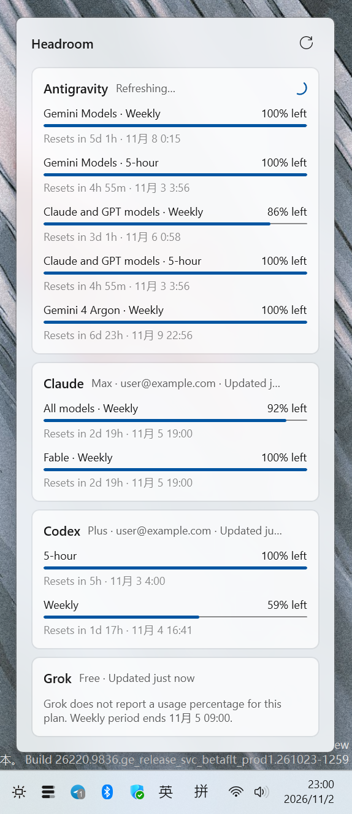

# Headroom



Headroom is a small Windows tray app that shows how much quota you have left in your AI coding CLIs: **Antigravity (`agy`)**, **Claude Code**, **Codex**, and **Grok**.

It does not talk to any vendor server itself. It runs the CLIs you already have installed and signed in, asks them for your usage the same way you would by hand, and shows the result in a panel in the taskbar notification area.

## Will this get my account banned, or use up my tokens?

Headroom is designed to avoid both:

- **No unofficial API access.** It never reads your stored credentials, never calls private web endpoints, and never imitates a browser or a CLI. The usage data comes from the vendor's own CLI.
- **No prompts are sent.** Every query is a local command or an account query (see [How it works](#how-it-works)). None of them starts a conversation with a model, so polling uses no tokens and no message quota.
- **Old CLIs are skipped.** On an old CLI, `/usage` might be treated as an ordinary prompt, so Headroom checks the version first (agy ≥ 1.1.11, Claude Code ≥ 2.0) and refuses to run it otherwise.
- **Your setup is left alone.** Probes run with a read-only sandbox (Codex), with hooks and MCP servers disabled for that one process (Claude Code), and with self-updates disabled (agy). Your saved settings are not changed. Claude Code transcripts created by the probe are deleted afterwards.
- **Signed-out CLIs are not hammered.** Claude Code's login is checked before `/usage` runs. If agy is signed out, Headroom stops polling it until you press Refresh, so it cannot keep trying to sign in.

The traffic is what the CLI itself sends when you check usage by hand, a few times an hour. This is not a guarantee from any vendor; check their terms if you are unsure.

<br clear="right">

## How it works

For each tool, Headroom runs one of these commands or protocols, which the CLI provides for reading usage, and parses the output:

| Tool | What Headroom runs |
| --- | --- |
| Antigravity | `agy -p /usage --output-format json`: the CLI's built-in usage report. |
| Claude Code | `claude auth status --json` to check the login, then `claude /usage`: the same `/usage` command you can type in Claude Code. |
| Codex | `codex app-server`: the JSON-RPC server Codex provides for editor integrations, queried with `account/read` and `account/rateLimits/read`. |
| Grok | `grok agent stdio`: Grok's Agent Client Protocol server, queried with its `_x.ai/billing` method. |

Tools whose CLI is not installed are hidden. By default, usage refreshes every 5 minutes, when the panel is opened with data older than 2 minutes, or on demand from the refresh button or the tray menu. All of this can be changed in Settings.

## Install

<a href="https://apps.microsoft.com/detail/9N2X3T516ZFW?mode=direct"></a>

Requires Windows 10 2004 or later and at least one of the supported CLIs installed and signed in.

Right-click the tray icon for **Refresh now**, **Settings**, and **Quit**. In Settings you can make Headroom start with Windows, turn off tools you don't want to see (they are then never run), and choose how often usage refreshes, including manual only. Windows puts new tray icons in the overflow area (^); drag the icon next to the clock to keep it visible.

## Build

Requires the .NET 10 SDK.

```powershell
dotnet build src/Headroom -p:Platform=x64
dotnet test tests/Headroom.Core.Tests
```

The default build is unpackaged and bundles the Windows App SDK. The Microsoft Store package (x64 and ARM64) is built with Visual Studio's MSBuild:

```powershell
msbuild src/Headroom -restore -p:Configuration=Release -p:Platform=x64 -p:Packaged=true -p:GenerateAppxPackageOnBuild=true -p:UapAppxPackageBuildMode=StoreUpload -p:AppxBundle=Always "-p:AppxBundlePlatforms=x64|ARM64" -p:AppxPackageDir=$PWD\artifacts\AppPackages\
```

## Project layout

- `src/Headroom.Core`: CLI discovery, usage providers, and output parsers (no UI).
- `src/Headroom`: the WinUI 3 app: tray icon, flyout panel, view models.
- `tests/Headroom.Core.Tests`: parser and behavior tests based on real CLI output.

## License

Headroom is licensed under the [GNU General Public License v3.0](LICENSE).

Headroom is not affiliated with Google, Anthropic, OpenAI, or xAI. Product names are used only to identify the CLIs it works with.
